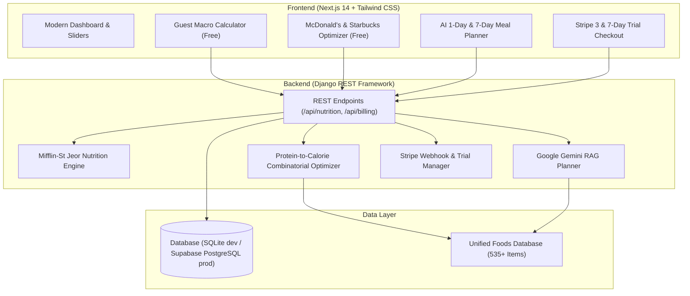

# ⚡ NutriFit.AI — Fitness & Macro Nutrition Intelligence Platform

> **Engineered for Junior AI Engineer Portfolio Evaluation**  
> Fullstack AI SaaS combining deterministic metabolic algorithms, RAG meal planning (Google Gemini), real-world Kaggle nutrition datasets, unauthenticated guest tools, and Stripe 3 & 7-day free trials.

---

## 🎯 Project Overview

**NutriFit.AI** is an intelligent fitness nutrition platform designed to help users lose fat, build muscle, or recomp without friction. Unlike basic AI wrappers, NutriFit.AI combines:
1. **Clinical Metabolic Math**: Harris-Benedict & Mifflin-St Jeor formulas for exact Basal Metabolic Rate (BMR), Total Daily Energy Expenditure (TDEE), and macro splits.
2. **Real-World Food Datasets**: Preprocessed datasets from **McDonald's**, **Starbucks**, and **Open Food Facts** (535+ items).
3. **The "Eat Out & Stay on Track" Optimizer**: Solves real-world dilemmas (*"I have 450 kcal and 30g protein left today, what can I order at McDonald's or Starbucks?"*) using macro-density scoring.
4. **AI RAG Meal Planner**: Structured daily meal plans generated with **Google Gemini (Free Tier)**, grounded in the food database with a deterministic heuristic fallback.
5. **Freemium & SaaS Billing**: Unauthenticated guest access for instant calculations + **3-Day and 7-Day Free Trials** via Stripe Subscriptions.

---

## 🏗️ Architecture



---

## 📊 Datasets & Data Engineering

| Dataset | Source | Raw Size | Cleaned Records | Key Attributes |
| :--- | :--- | :--- | :--- | :--- |
| **McDonald's Menu** | Kaggle | ~30 KB | 260 items | Calories, Protein, Carbs, Fats, Sodium, Fiber |
| **Starbucks Drinks** | Kaggle | ~40 KB | 242 items | Calories, Protein, Fats, Sugar, Caffeine, Dairy/Milk variants |
| **Open Food Facts** | World Food Facts | 40+ GB raw dump | Curated fitness staples | Whole-food bodybuilding staples (Chicken, Rice, Whey, Oats, Eggs, Salmon) |

### Cloud Data Pipeline for Open Food Facts
To avoid downloading the full 40GB Open Food Facts dataset to a local machine, we provide a cloud extraction script:
* **Script**: [`data/scripts/colab_openfoodfacts_pipeline.py`](file:///home/kader/Documents/AI_Fitness/data/scripts/colab_openfoodfacts_pipeline.py)
* **Design**: Uses chunked streaming (`chunksize=50,000`) in Google Colab / Kaggle Notebooks to filter out incomplete rows, validate caloric plausibility (rejecting items with >950 kcal/100g), and extract high-protein fitness staples.

---

## 🤖 AI & Algorithmic Highlights

### 1. Protein-to-Calorie Density Scoring
When searching for restaurant meals, items and combos are ranked by macro efficiency:
$$\text{Protein Efficiency Score} = \frac{\text{Protein (g)} \times 4}{\text{Total Calories}} \times 100$$
This instantly surfaces optimal food choices (e.g. *Artisan Grilled Chicken* or *Egg White Delight*).

### 2. Dual-Engine Meal Planner (Gemini RAG + Heuristic Fallback)
* **Primary**: Google Gemini 1.5/2.0 Flash with few-shot JSON schema enforcement. Real food items from the local database are injected as retrieval context.
* **Fallback**: A deterministic combinatorial solver ensures that even if an API key is missing or rate-limited, the application **always succeeds** with 99%+ caloric accuracy.

---

## 💳 SaaS & Free Trial Flow

* **Guest Visitor (No Login)**:
  * Full access to BMR/TDEE Macro Calculator.
  * Full access to McDonald's & Starbucks Optimizer.
  * 1-Day sample AI meal plan preview.
* **Pro Free Trial (3 or 7 Days)**:
  * Rolling 7-day personalized plans.
  * Conversational meal customization.
  * Stripe Hosted Checkout with native `trial_period_days`.
  * Automatic Stripe webhook reconciliation.

---

## 🚀 Quickstart Guide

### 1. Backend (Django)
```bash
cd backend
# 1. Activate virtual environment
source venv/bin/activate

# 2. Run migrations & seed nutrition dataset
python manage.py migrate
python manage.py seed_foods

# 3. Start API server
python manage.py runserver 0.0.0.0:8000
```
*API will run at:* `http://localhost:8000/`

### 2. Frontend (Next.js with Bun)
```bash
cd frontend
# 1. Install dependencies with Bun
bun install

# 2. Start development server
bun dev

# 3. Production build
bun run build
```
*Web application will run at:* `http://localhost:3000/`

### 3. Environment Variables (`backend/.env`)
```ini
DEBUG=True
DJANGO_SECRET_KEY=your-secret-key
GEMINI_API_KEY=your-free-gemini-key      # Optional (auto fallback enabled)
STRIPE_SECRET_KEY=sk_test_...            # Optional (simulation mode enabled)
STRIPE_PUBLISHABLE_KEY=pk_test_...
FRONTEND_URL=http://localhost:3000
```

---

## 🧪 Testing

Run backend automated test suite:
```bash
cd backend
venv/bin/python3 test_api_endpoints.py
```
*Runs automated checks for health endpoint, macro calculations, fast-food combo search, sample plan generation, and Stripe checkout.*

